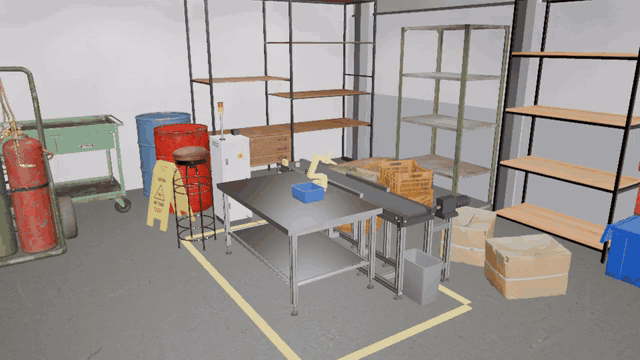

# smartcell

A simulated SO-101 robot arm picks a 32 mm part off a conveyor that keeps
running and places it in a box. The arm sees the scene through one camera on
its wrist. A small neural network trained from demonstrations does most of the
work, and a hand-written vision controller handles the final approach.

[](media/cell_film.mp4)

Project page with videos: https://smartcell-8cj.pages.dev (the interactive
simulator runs locally, see [Running it](#running-it)).

Built with MuJoCo 3.14 and PyTorch. MIT licensed.

## Results

Each condition was run 200 times with random seeds that were never used in
training. The network and the controller were frozen before these seeds were
drawn.

| Condition | Picked | Placed |
|---|---:|---:|
| Default scene (`nominal`) | 99.5% | 99.0% |
| Random lighting, part colour and camera mount (`tierB`) | 99.0% | 97.5% |
| Box moved to positions outside the training range (`boxX`) | 99.5% | 99.5% |

A run counts as placed only if the part was released, stayed inside the box
and moved slower than 0.05 m/s for 0.4 s. Touching the box is not enough.


The full protocol, confidence intervals and known weaknesses are in
[`docs/validation.md`](docs/validation.md). The weakest number is the lighting
condition: 97.5% placed, with a 95% Wilson lower bound of 94.3%.

## How it works


The policy is a 0.98 M-parameter convolutional network. It receives the last
eight grayscale wrist-camera frames (280 ms of history) and 12 joint values:
six measured joint angles and the six targets that were last sent to the
motors. It outputs the next eight arm and gripper targets at 25 Hz. Two of
them (80 ms) are executed, then it looks again.

On the last few centimetres a classical vision controller corrects the
policy. It finds the part and the box edge in the RGB image, projects them
onto the known table plane, leads the moving part and decides when to close
the jaws. A short rule-based step at the end opens the gripper only after the
part is held, lifted and lowered into the box.

Neither the network nor the vision controller reads object positions from the
simulator. They only use camera pixels, joint angles, forward kinematics and
the commands already sent. Details in [`docs/design.md`](docs/design.md).

## Getting it to work


The first trained policy picked the part in about 3% of runs. Most of the
improvement came from fixing the setup around the network:

- The early demonstrations started from a different pose, stopped the belt at
  the pick station and used a gripper command that only looked closed because
  the servo stalled. The data was re-collected with a belt that never stops
  and the real gripper limits.
- The wrist camera's near clipping plane cut off the gripper jaws, so the
  network could not see what it was holding. Correcting the camera setup
  brought the jaws back into view.
- Adding the last commanded targets to the input made the gripper's tracking
  error visible to the network. A closed gripper holding a part and an empty
  closed gripper now produce different inputs.
- Running at 25 Hz with an eight-frame history and re-planning every 80 ms was
  needed to catch a moving part. Longer open-loop chunks arrived too late.
- 948 correction episodes were collected with DAgger from states the policy
  actually reached and added to training. Validation and test data stayed on
  the original expert episodes.
- The success metric was tightened from "the part touched the box" to "the
  part is released and stays in the box", and the release step and the box
  detection were added to meet it.

A later checkpoint (`policy_0041f`) had a lower validation loss but failed the
rollout tests and was rejected. For this task, validation loss alone was not a
reliable way to pick a model.

## Furnished hall

[](media/policy.mp4)

The same frozen controller, without any retraining, was also run in a version
of the cell filled with 49 props from Poly Haven. The props are visual only
(`contype=0`, `conaffinity=0`), so the robot, belt, parts and box behave
exactly as before. This checks how well the controller copes with a busier
camera image.

| Condition | Runs | Picked | Placed | Placed, 95% interval |
|---|---:|---:|---:|---|
| Default scene | 100 | 100/100 | 99/100 | 94.6–99.8% |
| Random lighting, colour and camera mount | 50 | 50/50 | 50/50 | 92.9–100.0% |
| Box moved | 50 | 50/50 | 50/50 | 92.9–100.0% |
| Default scene, vision controller off | 50 | 43/50 | 30/50 | 46.2–72.4% |

With the vision controller on, 199 of 200 parts were placed. On the same 50
seeds with it switched off, only 30 were placed, so the vision controller is
what handles the change in scenery. Raw reports are in [`reports/`](reports/).

## Smoother motion

The policy sends one arm target every 40 ms. Originally the simulator held
each target constant until the next one arrived, so the position controllers
followed a 25 Hz staircase and the arm visibly shook.
[`smartcell/smoothing.py`](smartcell/smoothing.py) moves the target linearly
from one value to the next within each step. The network, the checkpoint and
the evaluation code are unchanged, and the original behaviour is still the
default for the evaluation scripts.

| Same 8 episodes, joint angles sampled at 200 Hz | Original | Smoothed |
|---|---:|---:|
| RMS jerk | 100% | 43% |
| RMS acceleration | 100% | 55% |
| High-frequency residual | 100% | 84% |

With smoothing, 44 of 44 test runs placed the part (20 default, 12 lighting,
12 box moved). That is a much smaller test than the 200-run protocol above. A
stronger version that also low-pass filtered the command looked calmer but
placed only 16 of 20, because the extra lag made it miss grasps, so it was
dropped. Measurement script: [`tools/measure_smoothing.py`](tools/measure_smoothing.py),
per-episode results: [`reports/smoothing_validation_20261123.json`](reports/smoothing_validation_20261123.json).

## Training data


| | |
|---|---:|
| Training episodes | 1,191 (243 expert demonstrations, 948 DAgger corrections) |
| Training samples | 549,436 |
| Validation / test episodes | 30 / 30 |
| Distinct training seeds | 2,302 |
| Belt speed | 0.068–0.092 m/s |
| Part rotation | any angle |
| Box offset | ±60 mm in x and y |

Every episode draws a new belt speed, part rotation, box position, start pose,
lighting, part colour and camera-mount offset.


The clip above is the raw 128×128 wrist camera at 25 Hz ([MP4](media/dataset.mp4)).
The dataset itself is tens of gigabytes and is not included. The code that
generates it and the conveyor configuration (`ds_0011/manifest.jsonl`) are.
See [`docs/dataset.md`](docs/dataset.md).

## Running it

```bash
pip install -r requirements.txt

# local web page with the live simulation (http://127.0.0.1:8800)
python web/server.py

# 20 evaluation runs in the default scene
python smartcell/evaluate.py --ckpt ckpt/policy_0041c.pt --n 20

# viewer: overhead camera, wrist camera and the exact input the network sees
python smartcell/watch.py --ckpt ckpt/policy_0041c.pt

# the furnished hall
python smartcell/evaluate_imported.py --ckpt ckpt/policy_0041c.pt --n 20 --conds nominal

# tests
python -m unittest discover -s tests -v
```

A GPU is recommended. Without one, set `SMARTCELL_ALLOW_CPU=1`; the simulation
then runs well below real time. On headless Linux set `MUJOCO_GL=egl`. The web
page can also be hosted as a static site, see [`docs/deploy.md`](docs/deploy.md).


## Code layout

All Python modules are in [`smartcell/`](smartcell/) and are run from the
repository root, for example `python smartcell/evaluate.py`.

| Area | Files |
|---|---|
| Evaluation and viewing | `evaluate.py`, `evaluate_imported.py`, `watch.py` |
| Controller | `model.py` (network), `wrist_vision.py` (vision controller), `policy_runtime.py` (grasp, release and placement logic), `carry_policy.py`, `current.py` (runtime settings), `smoothing.py` |
| Simulation | `build_cell.py`, `conveyor_env.py`, `conveyor_drive.py`, `arm_ik.py`, `cam_variant.py`, `mjbox.py` |
| Scene | `factory_hall.py`, `line_frame.py`, `scene_look.py`, `make_textures.py`, `blender_props.py` |
| Data collection | `expert.py`, `demo_pick.py`, `collect_state.py`, `dagger_collect.py`, `collect_carry_corrections.py`, `render_dataset.py`, `build_cache.py`, `dataset.py` |
| Training | `train.py`, `gpu_guard.py`, `ramcap.py` (memory limit) |

Other folders: `web/` (local web demo), `tools/` (smoothness measurement and
static site build), `ckpt/` (the evaluated checkpoint), `docs/`, `reports/`
(raw evaluation output), `media/`, `ds_0011/` (conveyor configuration) and
`tests/`.

The checkpoint and the evaluation files are pinned by SHA-256 in
[`docs/provenance.md`](docs/provenance.md), so the published numbers can be
traced to the exact files that produced them.

## Limitations

Everything here is simulation: one part type, one arm, one conveyor layout.
The vision controller assumes a calibrated camera and a known table height.
There is no obstacle avoidance or safety layer, so none of this should be run
on real hardware near people as it is.

More detail: [validation](docs/validation.md), [model card](docs/model-card.md),
[dataset](docs/dataset.md), [design notes](docs/design.md),
[provenance](docs/provenance.md), [third-party licences](THIRD_PARTY.md).
If you use this work, see [`CITATION.cff`](CITATION.cff).
