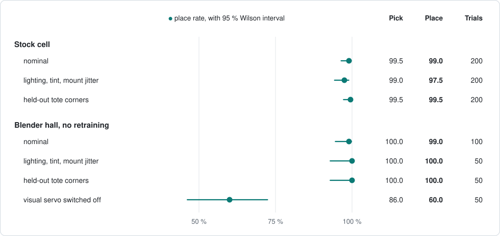

<div align="center">

# smartcell

### still running

**A SO-101 picks a 32 mm part off a conveyor that never stops — and places it in a tote.**

[](media/cell_film.mp4)

`MuJoCo 3.14` · `25 Hz` · `one wrist camera` · `no object state` · `MIT`

</div>

## The result

Fresh seeds, frozen checkpoint, **200 trials per condition**:

| Condition | Pick | Place |
|---|---:|---:|
| nominal | **99.5%** | **99.0%** |
| tierB — lighting, tint, mount jitter | **99.0%** | **97.5%** |
| boxX — held-out tote corners | **99.5%** | **99.5%** |

A *place* means the part was released, stayed inside the tote, and moved
slower than 0.05 m/s for 0.4 s. Touching the tote does not count.



The checkpoint and controller were frozen before the final seed stream. The
400 evaluation objects have zero overlap with 2,302 training seeds. Full
protocol, Wilson intervals and caveats: [`docs/validation.md`](docs/validation.md).

## How it works


- **A frozen behaviour-cloning policy** reads 8 grayscale wrist frames
  (280 ms of history) plus 12 proprio values, and predicts an 8×6 action
  chunk. Two entries (80 ms) are executed before it looks again.
- **A classical RGB wrist servo** back-projects the part and tote onto the
  known work plane. It leads the moving part, gates the close at predicted
  contact, and fits the tote before descending.
- **A proprioceptive release primitive** confirms a stalled close, a lift, and
  a low descent away from the belt before opening the jaws.

The policy is frozen. The servo adds no learned parameters and no simulator
object state — only pixels, joints, forward kinematics and the commands it
already sent. More in [`docs/design.md`](docs/design.md).

## The hard part

The first working policy picked about **3%** of the time. The useful history
is the list of things that were actually wrong:

- **The old data described a different machine.** Episodes started at `HOME`,
  the belt stopped at the index station, and "close" was a half-shut claw that
  only looked closed because the servo stalled.
- **The wrist camera clipped the gripper out of its own view.** The near plane
  cut the jaws off. The policy could not see what it was holding.
- **The policy had no sense of its own grip.** Feeding back `SOLL` (commanded
  target) next to `IST` (measured joint) made the gripper tracking error
  observable. A held part and an empty close became different inputs.
- **The belt does not wait for a 200 ms chunk.** 25 Hz, eight-frame history and
  two-entry execution (80 ms) was the difference between chasing and catching.
- **The policy had to survive its own mistakes.** 948 DAgger correction
  episodes, collected from states the policy actually visited, were added to
  training. Validation and test stayed on the original expert split.
- **A grasp is not a place.** The strict metric, a release primitive and a
  tote-fit check turned "the part touched the tote" into "the part stayed
  there".

A lower-validation-loss continuation (`policy_0041f`) failed the rollout gate
and was rejected. Validation loss alone is not a selection metric here.

## Zero-shot in a dressed cell

[](media/policy.mp4)

The same frozen controller, with **no retraining**, in the MuJoCo cell with 49
Blender props imported as **visual-only** geometry (`contype=0`,
`conaffinity=0`). Robot, belt, parts, tote and bin physics are untouched. This
tests visual robustness, not new contact physics.

| Condition | Trials | Pick | Place | Place Wilson 95% |
|---|---:|---:|---:|---|
| nominal | 100 | **100.0%** (100/100) | **99.0%** (99/100) | 94.6–99.8% |
| tierB — lighting, tint, mount jitter | 50 | **100.0%** (50/50) | **100.0%** (50/50) | 92.9–100.0% |
| boxX — held-out tote corners | 50 | **100.0%** (50/50) | **100.0%** (50/50) | 92.9–100.0% |
| nominal, visual servo disabled (control) | 50 | 86.0% (43/50) | 60.0% (30/50) | 46.2–72.4% |

Across all three active dressed conditions, the hybrid controller achieved **199/200 (99.5%)** completed placements. On the same 50 nominal seeds, it placed **49/50 (98.0%)**; with the RGB servo disabled, it placed **30/50 (60.0%)**. The servo is what absorbs the visual shift. Raw reports in [`reports/`](reports/).

## The data


| | |
|---|---:|
| training episodes | **1,191** |
| — expert demonstrations | 243 |
| — DAgger corrections | 948 |
| training samples | **549,436** |
| validation / test episodes | 30 / 30 |
| unique training seeds | 2,302 across 42 manifests |
| line speed | 0.068–0.092 m/s |
| part yaw | full ±π |
| tote offset | ±60 mm in x and y |

Every episode samples a new belt speed, part yaw, tote offset, wait pose,
lighting, part tint and camera-mount jitter.


[MP4 version](media/dataset.mp4) · raw 128×128 wrist camera at 25 Hz, no
interpolation or colour correction. The dataset is **not shipped**; the code
and the running-line manifest are. See [`docs/dataset.md`](docs/dataset.md).

## Run it

```bash
pip install -r requirements.txt

# 20 nominal trials in the stock cell
python evaluate.py --ckpt ckpt/policy_0041c.pt --n 20

# live viewer: overhead + wrist RGB + the exact tensor the policy sees
python watch.py --ckpt ckpt/policy_0041c.pt

# zero-shot in the Blender-dressed cell
python evaluate_imported.py --ckpt ckpt/policy_0041c.pt --n 20 --conds nominal

# contract tests
python -m unittest discover -s tests -v
```

## What is in the box

| Path | |
|---|---|
| `evaluate.py` | rollout, hybrid visual pick/place, conditions, seed streams |
| `watch.py` | live viewer and policy-input montage |
| `wrist_vision.py` | RGB wrist servo (pick + place geometry) |
| `policy_runtime.py` | dwell, release primitive, placement monitor |
| `build_cell.py` | robot, conveyor, table, hall, lighting |
| `blender_props.py` | visual-only set dressing loader |
| `ckpt/policy_0041c.pt` | the validated checkpoint |
| `docs/` | validation, model card, dataset, design, provenance |
| `reports/` | raw validation and benchmark JSON |

## Scope

This is a research artifact: **simulation, one 32 mm part, one SO-101, one
conveyor**. It is not a hardware promise, a product, or a safety system. The
visual servo assumes a calibrated camera and a known work plane.

- [Validation and caveats](docs/validation.md)
- [Model card](docs/model-card.md)
- [Dataset](docs/dataset.md)
- [Design notes](docs/design.md)
- [Provenance and hashes](docs/provenance.md)
- [Third-party licences](THIRD_PARTY.md)

MIT licensed. If you use it, [`CITATION.cff`](CITATION.cff) is there.
