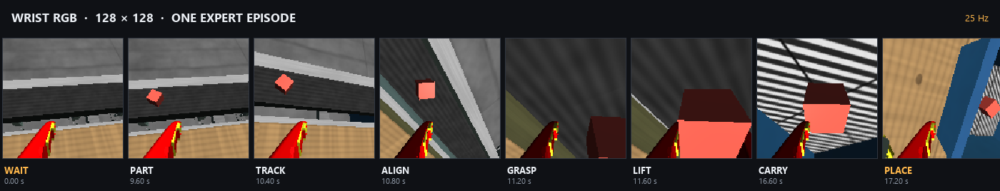
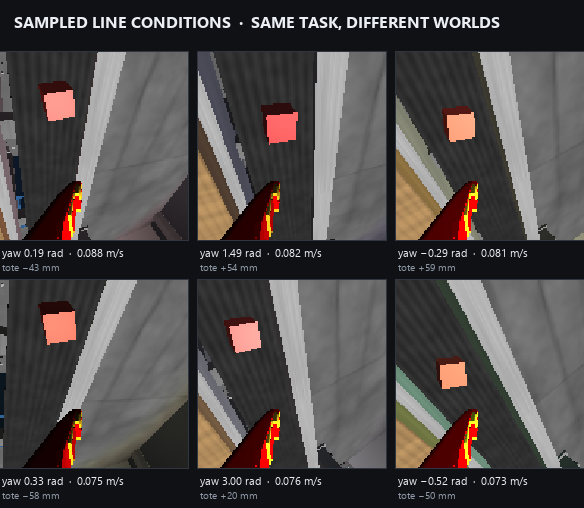
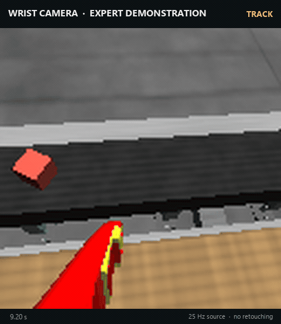

# Dataset

The dataset is not shipped. It is tens of gigabytes of rendered frames and
would make the repository useless to clone. What is shipped is the code that
made it, the manifest that defines the running line, and the media below.



## What the policy sees

Each sample is:

| Input | Shape | Notes |
|---|---|---|
| wrist frames | `8 × 96 × 96` uint8 | newest first, 40 ms apart, 280 ms lookback |
| proprio | `12` floats | `IST 6` measured joints + `SOLL 6` commanded targets |
| target | `8 × 6` floats | future joint/gripper targets, 25 Hz |

The `SOLL` half is the important one. It gives the policy a direct
grip-tracking signal: a closed jaw that stalls on a part has a very different
`SOLL − IST` than an empty close. No simulator object state enters the policy.

## How much data

| | |
|---|---:|
| training episodes | 1,191 |
| of which expert demonstrations | 243 |
| of which DAgger corrections | 948 |
| training samples | 549,436 |
| validation / test episodes | 30 / 30 |
| unique training seeds | 2,302 across 42 manifests |
| line speed | 0.068–0.092 m/s |
| part yaw | full ±π |
| tote offset | ±60 mm in x and y |

The 400 fresh evaluation objects in the final validation are disjoint from all
recorded training and historical evaluation seeds. The audit is in
[`reports/visual_both_v12_fresh_seed_audit_20261026.json`](../reports/visual_both_v12_fresh_seed_audit_20261026.json).

## Variation



Every episode samples a new belt speed, part yaw, tote offset, wait pose,
lighting, part tint, and camera-mount jitter. The final controller was tested
on three condition families:

- `nominal`: default cell and camera mount.
- `tierB`: lighting, part colour and camera-mount offset drawn per episode.
- `boxX`: box placed at three corners outside the training range.

## One episode



[MP4 version](../media/dataset.mp4)

The sequence is the raw 128×128 wrist camera at 25 Hz, from the part entering
view to the placed part. No frame interpolation, no colour correction.

## Regenerating it

The pipeline is included but not runnable without a GPU and time:

```bash
# expert rollouts (successful episodes only are kept)
python smartcell/collect_state.py --target 300 --workers 4 --out ds_0011

# 128x128 RGB wrist frames, 25 Hz
python smartcell/render_dataset.py --all --ds ds_0011

# align frames, joints and commands into the training cache
python smartcell/build_cache.py --ds ds_0011 --fps 25 --entry 0.04 --out cache_0011

# one correction round; the validated run used 12 rounds (d16..d27)
# plus two visual-domain rounds (ds_0016_look, ds_0017_look)
python smartcell/dagger_collect.py --n 64 --out ds_0011_d16 --ds ds_0011 --base-seed 100000

# train with every correction round as extra data
python smartcell/train.py --epochs 40 \
  --extra-ds ds_0011_d16,...,ds_0011_d27,ds_0016_look,ds_0017_look \
  --extra-cache cache_0011_d16,...,cache_0011_d27,cache_0016_look,cache_0017_look
```

The exact dataset used for the validated checkpoint is `ds_0011` +
`cache_0011` plus 12 DAgger rounds and two visual-domain rounds (948
correction episodes in total). It is intentionally not committed.
