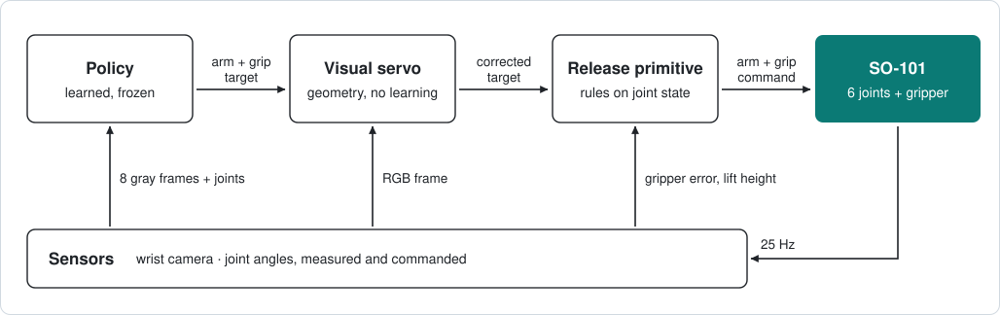

# Design notes

## Overview

The controller has three parts that run on the same wrist-camera stream.

1. A behaviour-cloning policy, frozen after training. It reads eight grayscale
   wrist frames (280 ms of history) and 12 joint values and predicts an 8×6
   action chunk. The evaluator executes two entries (80 ms) and then queries
   the policy again.
2. A classical RGB visual servo. It back-projects pixels onto the known work
   plane, locates the top of the part and the edge of the box, and adjusts the
   arm and gripper targets during the final approach.
3. A release step based on joint readings. It checks that the gripper stalled
   on the part, that the part was lifted, and that the arm has descended away
   from the belt before it opens the jaws.

The servo has no learned parameters and does not read object state from the
simulator. Its inputs are RGB pixels, joint angles, forward kinematics and the
actuator commands that were sent.

The policy was not retrained end to end with the servo. The servo was added
afterwards and corrects the policy's output.

## From 3% to 99%

The first trained policy picked the part in about 3% of runs. The improvement
came from a series of fixes, most of them outside the network:

- Early datasets started at `HOME`, stopped the belt at the index station and
  commanded a half-shut gripper (`0.02 rad`) that only looked closed because
  the servo stalled on the part. The data was collected again starting from
  the wait pose, with a belt that never stops and the actuator's real lower
  bound as the close command.
- The wrist camera's near clipping plane cut off the gripper jaws, so the
  policy could not see what it was holding. Fixing the camera setup made the
  jaws visible.
- The proprio input was extended with `SOLL`, the command actually sent, next
  to `IST`, the measured joint. The difference is the gripper's tracking
  error, which separates a closed gripper holding a part from an empty one.
- Moving to 25 Hz with an eight-frame history and two-entry execution (80 ms)
  let the arm follow the moving part. With 200 ms open-loop chunks it arrived
  too late.
- 948 DAgger correction episodes were collected from states the policy
  actually reached and added to the training set. Validation and test stayed
  on the original expert split.
- The success metric now requires release, the part staying in the box, and a
  speed below 0.05 m/s for 0.4 s. The release step and the box detection were
  written to pass that metric. Before, a part that touched the box counted.
- The RGB servo handles the last centimetre. The policy still does the wait
  and the approach. The servo tracks the moving part, aims 0.25 s ahead of it,
  closes the jaws at the predicted contact time and checks the box outline
  before descending.
- MuJoCo's `implicitfast` integrator renders the kinematics from before the
  final hinge update. The first servo version paired each image with the
  joint angles after the step. Version 9 uses `q − dt·v` and a 5 ms offset
  instead; an independent geometry test matches the rendered camera pose to
  `1e-12`.

## Rejected options

- A continuation checkpoint (`policy_0041f`) reached a lower validation loss
  but performed much worse in closed-loop rollouts, so it was not used.
- Temporal ensembling, an entry-edge dwell, carry lookahead and a learned
  carry head were tested. None of them helped, and they are off by default.
- A second neural network for the final approach was considered. Because the
  geometry is planar and the camera is calibrated, a classical servo was
  simpler to build and easier to check.

## Evaluation setup

The controller and checkpoint were frozen before the final seed stream was
generated. An audit confirms that the 400 evaluation objects do not overlap
with the 2,302 training seeds or the 280 seeds used in earlier evaluations.
The final report contains source hashes, runtime settings, per-episode records
and Wilson intervals. The repository also includes 17 runtime and vision
tests and a 12-trial regression run.

All results are from simulation with one 32 mm part, one SO-101 and one
conveyor layout. They say nothing about performance on real hardware.
